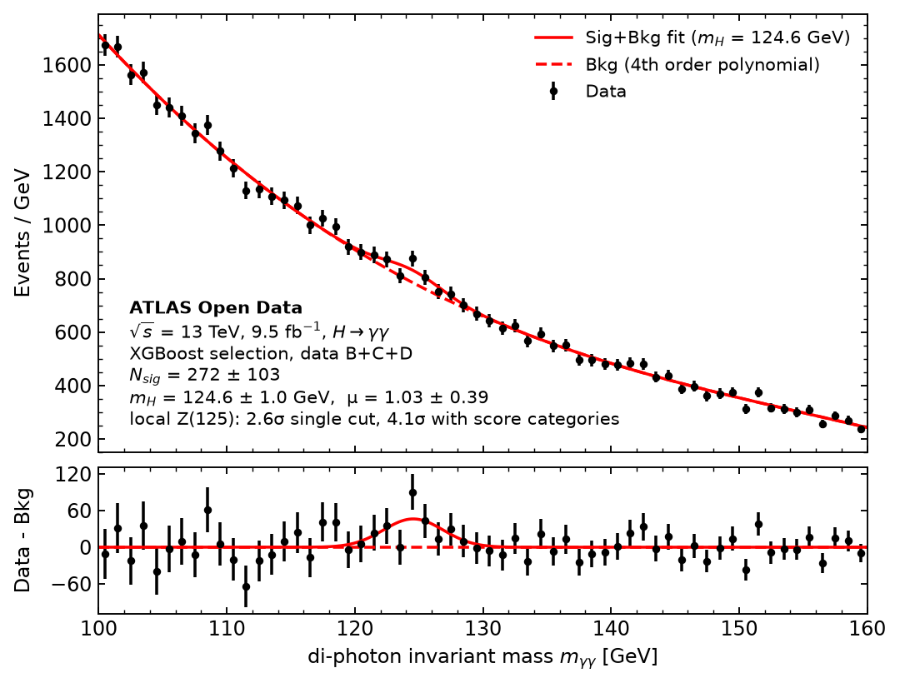
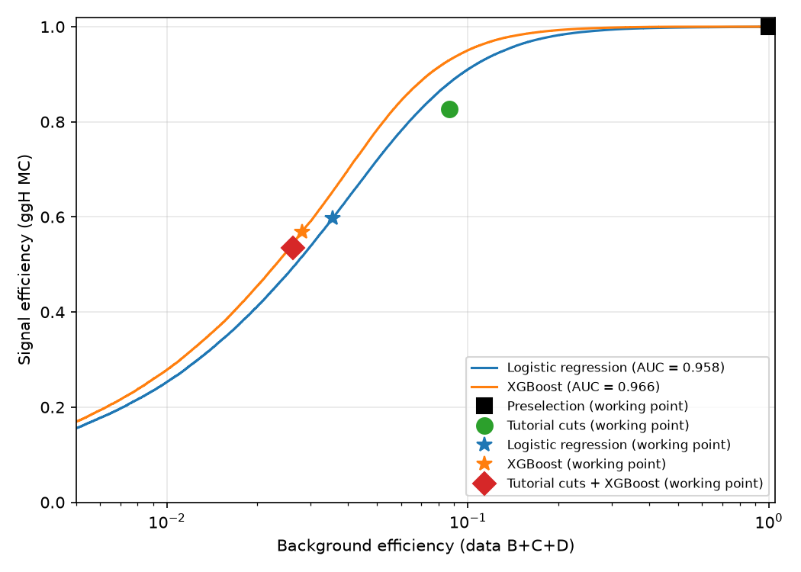
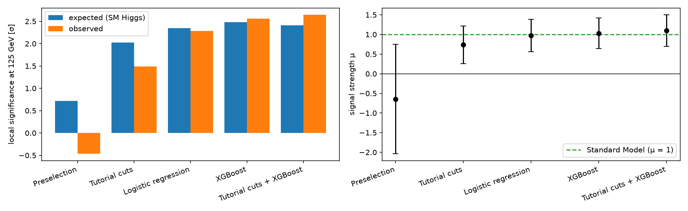
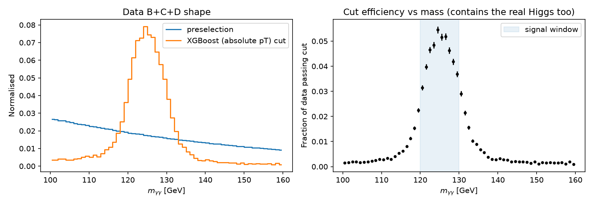

# H → γγ with ATLAS Open Data: cuts vs logistic regression vs boosted trees

This project looks for the Higgs boson as a narrow peak at 125 GeV in the diphoton invariant mass spectrum, using the ATLAS 13 TeV Open Data (`GamGam` samples, 10 fb⁻¹). Three ways of separating signal from background are compared:

1. the hand-made **tutorial cuts** (photon isolation + tight identification),
2. a **logistic regression**,
3. a **gradient-boosted decision tree (XGBoost)**.

Each one is then used to measure the Higgs signal in real data.



## Headline result

On data periods **B + C + D (9.5 fb⁻¹)**, which were never used for training or for choosing cuts:

| | XGBoost single cut | XGBoost score categories (5) |
|---|---|---|
| fitted Higgs mass | **124.6 ± 1.0 GeV** | (fixed at 125 GeV) |
| signal strength μ = N_obs / N_SM | **1.03 ± 0.39** | 1.43 ± 0.35 |
| local significance at 125 GeV (observed) | **2.6σ** | **4.1σ** |
| local significance (expected for SM Higgs) | 2.5σ | 2.9σ |

The background-only p-value, scanned over the mass hypothesis, is lowest at **exactly 125.0 GeV** ([p₀ scan](results/figures/p0_scan.png)).

Errors are statistical only. Significances are local: no look-elsewhere correction and no systematic uncertainties.

## Data and strategy

| sample | role |
|---|---|
| `mc_343981.ggH125_gamgam` (MC) | signal. 50% test; the other 50% is split 80/20 into training/validation |
| `data_A` (0.5 fb⁻¹) | **background for training** (80/20 training/validation). In 100–160 GeV it holds ~96k events and only ~50 real Higgs events |
| `data_B`, `data_C`, `data_D` (9.5 fb⁻¹) | **test data**: ROC curves are measured and the Higgs is fitted here |

Rules that keep the result honest:
- **m_γγ is never a classifier input.** Photon momenta enter only as pT/m_γγ (see *Mass sculpting* below).
- Hyper-parameters, early stopping and **score cuts are all chosen on the validation samples** by maximising the expected significance. Data B, C and D are only looked at for the final numbers.
- **Data A is never fitted.** The classifiers were trained to call its events background, including its ~50 Higgs events.
- The Higgs fit is a binned Poisson likelihood in 100–160 GeV: a 4th-order polynomial background plus a Gaussian signal whose width (2.34 GeV) comes from MC. The signal strength is μ = N_fit / N_SM, where N_SM is the MC expectation after the same selection.

### Classifier inputs (16)
| group | features |
|---|---|
| photon kinematics (scale-free) | pT1/m_γγ, pT2/m_γγ, pT_γγ/m_γγ, \|η1\|, \|η2\|, Δφ, \|cos θ*\|, \|y_γγ\| |
| identification / isolation | tightID ×2, E_T^cone20 ×2, p_T^cone30 ×2 (in GeV) |
| jets | number of jets and leading-jet pT, after the jet cleaning below |

Jet cleaning (`src/features.py::clean_jets`) keeps jets with pT > 25 GeV and |η| < 2.5. It applies the JVT pileup cut (JVT > 0.59 for pT < 60 GeV, |η| < 2.4) and removes jets within ΔR < 0.4 of either photon.

## Results: all selections on data B+C+D

From `notebooks/05_global_comparison.ipynb` (also in `results/scores/comparison_table.csv`):

| selection | sig. eff. | bkg. rej. | data events | S (SM) | S/√B | Z exp | Z obs | μ | m_H [GeV] |
|---|---|---|---|---|---|---|---|---|---|
| Preselection only | 1.000 | 0.000 | 1,649,068 | 454 | 0.79 | 0.72 | −0.47 | −0.64 ± 1.40 | (119.2 ± 1.7) |
| Tutorial cuts | 0.827 | 0.913 | 143,281 | 375 | 2.25 | 2.02 | 1.49 | 0.74 ± 0.48 | 124.2 ± 2.1 |
| Logistic regression | 0.597 | 0.964 | 58,718 | 271 | 2.62 | 2.35 | 2.29 | 0.97 ± 0.41 | 125.3 ± 1.0 |
| **XGBoost** | 0.568 | 0.972 | 46,279 | 258 | 2.77 | 2.48 | **2.56** | **1.03 ± 0.39** | **124.6 ± 1.0** |
| Tutorial cuts + XGBoost (ablation) | 0.535 | 0.974 | 43,291 | 243 | 2.70 | 2.41 | 2.64 | 1.10 ± 0.40 | 124.7 ± 0.9 |
| XGBoost, 5 score categories | — | — | — | 431 | — | 2.86 | 4.09 | 1.43 ± 0.35 | (125 fixed) |

Here S/√B is computed in the 120–130 GeV window, with B taken from the fitted background. Z exp is the likelihood significance on an Asimov dataset (fitted background plus the SM Higgs).

| classifier (MC test vs data B+C+D) | AUC | sig. eff. @ 1% bkg | sig. eff. @ 5% bkg | bkg. rej. @ 80% sig. eff. |
|---|---|---|---|---|
| Logistic regression | 0.958 | 0.253 | 0.720 | 0.936 |
| XGBoost | 0.967 | 0.278 | 0.784 | 0.948 |




### What we learn
- **Preselection alone sees nothing.** There are ~290k background events under ~450 Higgs events (S/√B ≈ 0.8).
- **The tutorial cuts do most of the work.** Isolation and tight ID remove 91% of the background, which is mostly jets faking photons, and raise the expected significance from 0.7σ to 2.0σ.
- **The classifiers beat the cuts.** The logistic regression reaches 2.35σ expected and XGBoost 2.48σ. The input importances agree: the photon ID and isolation variables dominate, and the kinematics (|cos θ*|, pT_γγ/m_γγ) add the rest. At 80% signal efficiency, XGBoost lets through ~18% less background than the logistic regression.
- **Ablation: should the tutorial cuts be part of the preselection?** For the classifier, no. Applying them before the XGBoost cut lowers the expected significance (2.41σ vs 2.48σ), because the BDT already uses the same variables more efficiently. They are still a good hand-made selection without a classifier.
- **Score categories beat a single cut.** Keeping all events and fitting five BDT-score categories with one common μ raises the expected significance from 2.5σ to 2.9σ. The scheme was chosen on expected significance only. The observed 4.1σ is above expectation, mainly because the loosest category fluctuates up (277 ± 124 events fitted vs 45 expected). The more conservative single-cut value is μ = 1.03 ± 0.39.
- **Stable across periods.** With the category fit, μ = 1.14 ± 0.75 (B), 1.16 ± 0.60 (C) and 1.73 ± 0.47 (D). The three are mutually consistent (χ²/ndf = 0.75/2).

### Mass sculpting: why pT/m_γγ and not pT
With absolute pT1, pT2 and the photon angles, a BDT can rebuild the mass, since m² = 2 pT1 pT2 (cosh Δη − cos Δφ). It then learns that "125 GeV is signal-like". That version gets a better AUC (0.988), but its cut carves a peak **into the background**: the fit returns a fake μ ≈ 32 at 94σ (notebook 04, section 5). With pT/m_γγ the cut efficiency changes smoothly with m_γγ, the polynomial background still fits, and μ agrees with the Standard Model.



## Does this establish the Higgs boson at 125 GeV?
The data B+C+D show:
1. a narrow excess in the diphoton spectrum, as wide as the detector resolution predicted by the Higgs MC;
2. at **m_H = 124.6 ± 1.0 GeV**, with the background-only p-value lowest at 125.0 GeV;
3. with the **rate predicted by the Standard Model** (μ = 1.03 ± 0.39 single cut, 1.43 ± 0.35 categories);
4. present in every independent selection and in each data-taking period;
5. not produced by the selection itself: the mass is hidden from the classifiers, and the sculpting checks show a smooth efficiency in m_γγ.

With 9.5 fb⁻¹ of test data this is **evidence** (2.6σ to 4.1σ local), not a 5σ discovery. That matches the expectation of about 2.5σ to 2.9σ for this luminosity and an inclusive analysis.

## Repository layout
```
notebooks/
  01_preselection_and_cutflow.ipynb   η-crack + pT preselection, cut flow, writes data/processed/*_preselection.root
  02_baseline_tutorial_cuts.ipynb     tutorial isolation + tight-ID cuts on data A
  03_logistic_regression.ipynb        features, logistic regression, cut choice, fit
  04_boosted_tree.ipynb               XGBoost (hyper-parameter scan, importance, fit, sculpting demo)
  05_global_comparison.ipynb          all selections side by side, score categories, p0 scan, per-period check
src/
  preselection.py, tutorial_cuts.py   cut definitions
  features.py                         m_γγ, jet cleaning, classifier features
  weights.py                          luminosities, MC weights, class balancing
  dataset.py                          loading + cached feature tables + fixed train/val/test split
  evaluate.py                         ROC metrics, Asimov Z, cut choice, likelihood fits (MyyFit, CategoryFit)
  classifier.py                       shared train/score/evaluate/save for notebooks 03-04
  plotting.py                         plot_data (tutorial style) and plot_fit
results/
  figures/   all plots
  scores/    *_summary.json, comparison_table.csv, global_comparison.json (score arrays *.npz are git-ignored)
  models/    xgboost.json
```

## Running
```bash
python -m venv .venv && source .venv/bin/activate
pip install -r requirements.txt     # on macOS XGBoost also needs: brew install libomp
```
Put the `GamGam` ROOT files in `data/raw/`, then run the notebooks in order (01 → 05). Notebook 01 writes the preselected files. The first run of 03 caches feature tables in `data/processed/*_features.npz` (delete these after changing `src/features.py`). XGBoost training takes about one minute on a laptop.

## Possible extensions
- Systematic uncertainties (photon energy scale and resolution, luminosity, choice of background function via spurious-signal tests).
- A look-elsewhere correction for a global significance.
- Add the VBF/VH/ttH signal samples and use the jet variables for production-mode categories.
